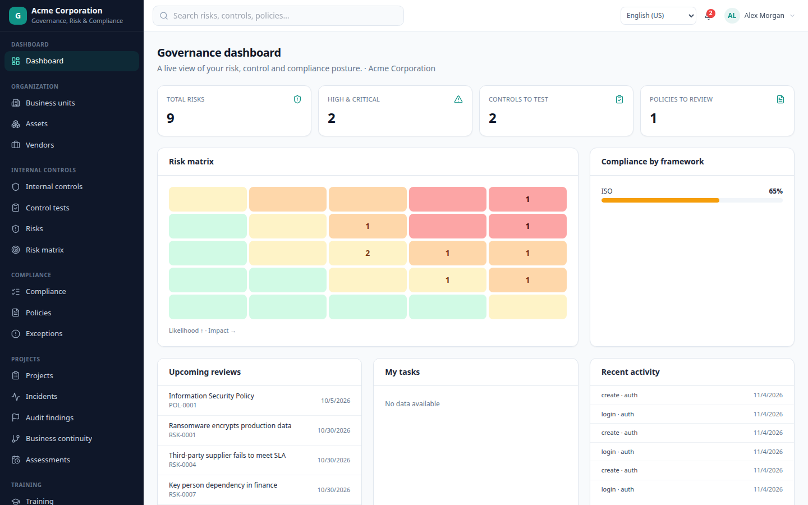
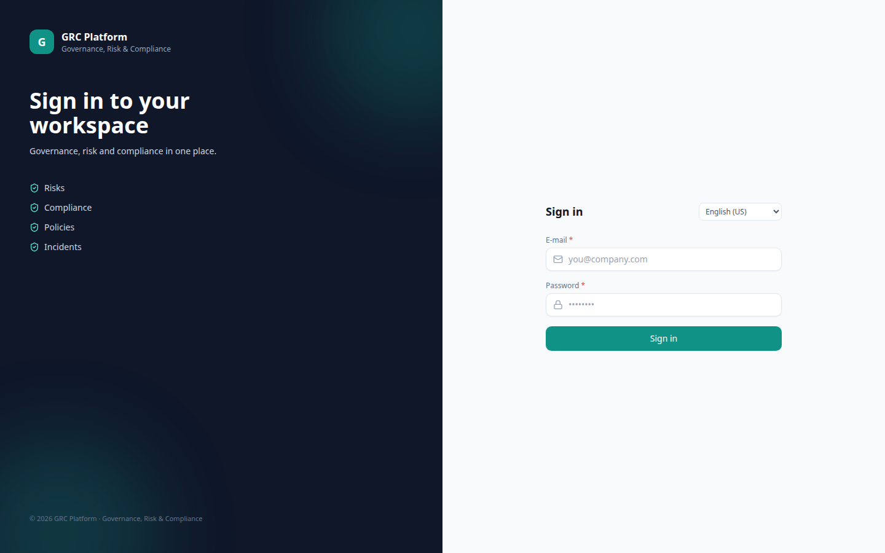
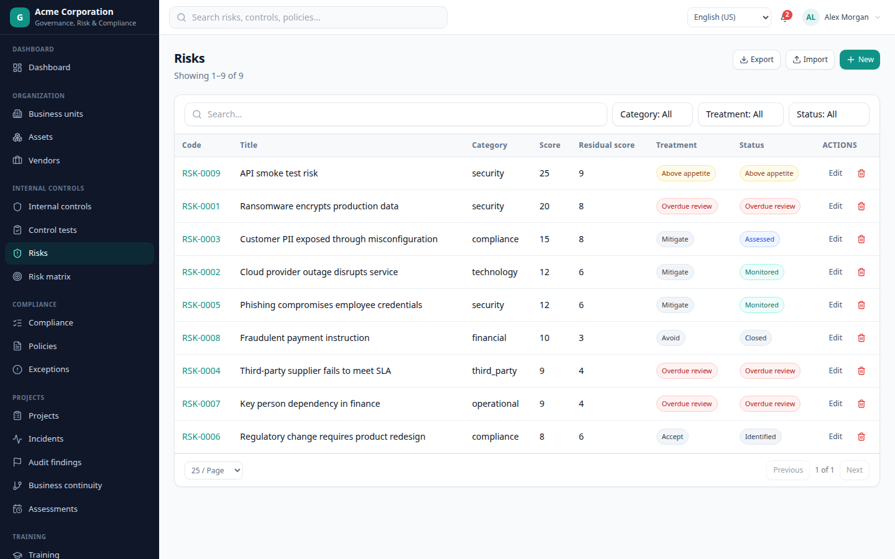
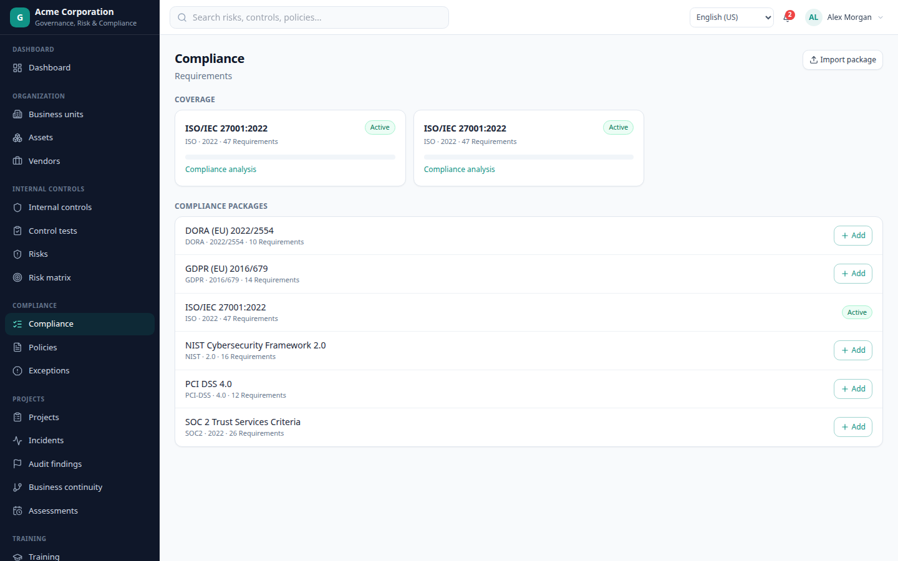
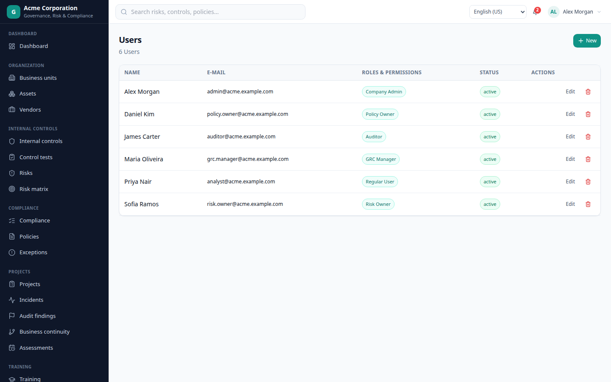

# GRC Platform

Multi-tenant Governance, Risk & Compliance SaaS (Eramba-equivalent) built with **NestJS 11**,
**Next.js 15**, **Prisma 6**, **PostgreSQL** and **BullMQ**, with 7 UI languages (RTL included),
pluggable authentication and pluggable file storage.



## What is included

| Area | Features |
| --- | --- |
| Platform | Multi-tenant companies, Super Admin, impersonation, audit trail, RBAC (6 default roles), saved views, custom fields/tabs, dynamic status rules, automation rules, webhooks, API tokens, AI assistant, MCP endpoint, global search |
| Organization | Business units, assets, vendors |
| Risks & controls | Risk register with 5x5 matrix, treatment/residual scoring, reviews, appetite, control library with tests and evidence |
| Compliance | ISO 27001, SOC 2, NIST CSF, GDPR, DORA, PCI DSS libraries, adoption, requirement mapping and coverage analysis, JSON import |
| Policies | Lifecycle, version history, publishing, acknowledgements |
| Operations | Projects + tasks, incidents, audit findings, exceptions, business continuity plans + tests |
| People | Assessments with public links, training, account reviews, whistleblowing channel |
| Privacy | Data flows and RoPA (processing activities) |
| i18n | en-US, pt-BR, es-MX, fr-FR, zh-CN, hi-IN, ar-SA (RTL) - 418 keys per locale, DB overrides, user > company > global resolution |
| Integrations | REST API, CSV import/export on every module, signed webhooks, BullMQ jobs (inline fallback), S3/MinIO or local storage |

## Screenshots

| Login | Risks |
| --- | --- |
|  |  |

| Compliance | Users & roles |
| --- | --- |
|  |  |

## Quick start (Docker)

```bash
cp docker/.env.example docker/.env
docker compose -f docker/docker-compose.yml up --build
```

- Web: http://localhost:3000
- API: http://localhost:3001/api/health
- Postgres: localhost:5433

Demo credentials (seeded automatically):

| Role | E-mail | Password |
| --- | --- | --- |
| Super Admin | `admin@example.com` | `admin123` |
| Acme Company Admin | `admin@acme.example.com` | `Password123!` |
| Globex Company Admin | `admin@globex.example.com` | `Password123!` |

Set `SEED_DEMO=false` to start with no demo companies.

## Local development

```bash
pnpm install
pnpm locales                              # regenerate /locales
pnpm --filter @grc/api db:push
pnpm --filter @grc/api db:seed
pnpm --filter @grc/api dev                # http://localhost:3001
pnpm --filter @grc/web dev                # http://localhost:3000
```

> Run the API through `ts-node` or compiled `tsc` output, not esbuild-only runners:
> NestJS relies on `emitDecoratorMetadata`.

## Authentication

`AUTH_METHOD` selects the strategy:

- `none` - dashboard fully open, requests run as the seeded Super Admin (demo only).
- `account` - e-mail/password. `ACCOUNT_LOGIN`/`ACCOUNT_PASSWORD` always map to the Super Admin;
  company users live in the database with scrypt hashes.
- `keycloak` - OIDC Authorization Code + PKCE. Redirect URI defaults to `${APP_URL}/api/auth/callback`.
  `KEYCLOAK_ACCOUNTS` is a space-separated allow list of exact e-mails and/or domains
  (`@corp.com`, `corp.com`). New identities are provisioned as Regular Users of the company matching
  their e-mail domain, otherwise as unassigned users.

reCAPTCHA v3 is configured **in the database** (Super Admin > Global settings), not in env. Login and
the public whistleblowing form are verified when both keys exist; the score threshold is configurable.

## Multi-tenancy

Every business table carries `tenant_id`. A Prisma client extension injects the tenant from
`AsyncLocalStorage` into every query/mutation, and tenant-scoped models declare
`@@unique([tenantId, id])` so `findUnique/update/delete` cannot cross tenants. Super Admins work in
platform mode (no tenant) or open a company through audited impersonation; company users can never
target another tenant, even by sending `x-tenant-id`.


## Internationalisation

- Source of truth: `tools/locales-source.mjs` → generated `locales/{locale}/common.json` + `modules/*.json`.
- Resolution order: user preference → company default → global default → `en-US`.
- Backend returns i18n **keys** (`messageKey`, statuses, field metadata) - never UI copy.
- `<html lang dir>` follows the resolved locale; `ar-SA` switches the whole layout to RTL.
- Super Admin → Translations overrides any key per locale (stored in `translations`).

## Storage

`STORAGE_DRIVER=local` writes to `STORAGE_LOCAL_ROOT/{tenantId}/…`; `s3` uses `@aws-sdk/client-s3`
(AWS, MinIO, R2, Wasabi) with optional presigned downloads. Every upload is recorded in `files` and
served through `/api/files/:id/download`.

## Verification

```bash
pnpm typecheck                 # API + web
pnpm --filter @grc/web build   # production build
node tools/e2e-smoke.mjs       # API smoke test (health, login, CRUD, tenant isolation)
node tools/screenshots.mjs     # regenerate docs/screenshots
```

## Repository layout

```
apps/api            NestJS API (Prisma schema, seed, modules)
apps/web            Next.js app router UI
locales             generated translations (7 locales)
tools               locale generator, smoke test, screenshots
docker              compose + .env.example
docs                setup, API, i18n notes and screenshots
plans               implementation plans and phase checklists
```

More detail: [docs/setup.md](docs/setup.md) · [docs/api.md](docs/api.md) · [docs/i18n.md](docs/i18n.md)

